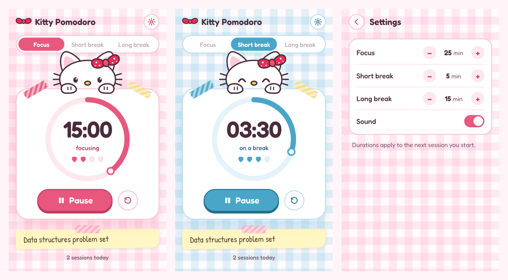

# Kitty Pomodoro

A small, calm Pomodoro timer for Chrome, with a kitty on the desk. Gingham, washi tape and a sticky note for what you're studying.

> An unofficial fan project. It is not affiliated with or endorsed by Sanrio. The mascot is an original drawing inspired by the style.

## What it does

- Focus, short break and long break timers (25 / 5 / 15 minutes by default)
- Keeps counting with the popup closed, and shows the minutes left on the toolbar icon
- A notification and a soft chime when a session ends
- Four hearts show how many focus sessions are left before a long break
- A sticky note for what you're working on, and a quiet count of today's sessions
- The kitty blinks, naps when you pause, and hops twice when you finish a session

Settings are deliberately tiny: the three durations, and sound on or off.

Keyboard: `Space` starts or pauses, the arrow keys switch modes. Motion is kept to a minimum and turns off with `prefers-reduced-motion`.

## Install

1. Clone the repo: `git clone https://github.com/julianthant/hello-kitty-pomodoro.git`
2. Open `chrome://extensions` and turn on **Developer mode**
3. Click **Load unpacked** and pick the repo folder
4. Pin the kitty icon to your toolbar

Needs Chrome 116 or newer.

## How it works

| File | Purpose |
| --- | --- |
| `background.js` | Service worker. Owns the timer, alarms, badge and notifications |
| `popup/` | The popup UI |
| `offscreen.js` | Plays the chime while the popup is closed (Manifest V3 offscreen document) |
| `shared/` | Defaults and helpers, plus a Web Audio music-box chime (no audio files) |
| `scripts/make-icons.js` | Regenerates the toolbar icons from `icons/kitty.svg` |
| `scripts/package.sh` | Builds `dist/kitty-pomodoro.zip` for the Chrome Web Store |

The timer stores an absolute end time, so it stays accurate even if Chrome puts the service worker to sleep or you restart the browser. Nothing leaves your machine. Permissions: `storage`, `alarms`, `notifications`, `offscreen`.

## Credits

- Fonts: [Fredoka](https://fonts.google.com/specimen/Fredoka) and [Patrick Hand](https://fonts.google.com/specimen/Patrick+Hand), under the SIL Open Font License (see `fonts/`)
- Design and motion restraint informed by [emilkowalski/skills](https://github.com/emilkowalski/skills) and [leonxlnx/taste-skill](https://github.com/leonxlnx/taste-skill)

## License

MIT. See [LICENSE](LICENSE).
